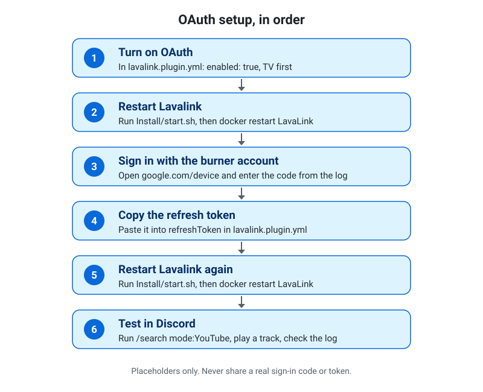
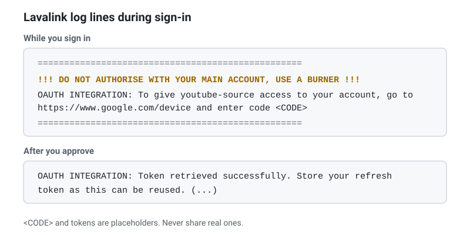

# PlexBot-YouTube-MusicProvider

**This extension works with PlexBot. PlexBot does not include YouTube, so to add it, clone this repository into PlexBot's `Extensions/` folder and rebuild the stack.**

```bash
git clone https://github.com/kalebbroo/PlexBot-YouTube-MusicProvider.git /path/to/PlexBot/Extensions/PlexBot-YouTube-MusicProvider
cd /path/to/PlexBot
Install/start.sh --build
```

If some YouTube tracks fail to play, check the [Troubleshooting](#troubleshooting) table first. If YouTube keeps refusing tracks, follow [Set up OAuth step by step](#set-up-oauth-step-by-step).

## What it does

This extension adds YouTube to PlexBot as a music source. It plays YouTube through Lavalink's youtube-plugin.

- **Search.** `/search mode:YouTube` searches YouTube and lists the results.
- **Links.** `/play` accepts a YouTube link to a single video or a playlist, and PlexBot queues the tracks.

The extension does not play audio itself. It asks Lavalink, the audio server PlexBot already uses, to look up YouTube.

## Why a plugin

The youtube-source README says that Lavaplayer's built-in YouTube source is deprecated, and names youtube-source as its replacement. On our test node (Lavalink 4.2.2), the built-in source failed on both search and direct URLs with "Something went wrong while looking up the track." We tested this on Lavalink 4.2.2 only. This extension uses youtube-plugin instead, and turns the built-in source off.

## Requirements

- PlexBot with Lavalink 4.x. PlexBot's Docker stack uses the `lavalink:4` image.
- Internet access for the Lavalink container. Lavalink downloads the youtube-plugin jar when it starts.
- Git, to clone this repository.

## Install

1. Clone this repository into PlexBot's `Extensions/` folder. The folder name must not end in `.disabled`, because that marks an extension as switched off.

   ```bash
   cd /path/to/PlexBot/Extensions
   git clone https://github.com/kalebbroo/PlexBot-YouTube-MusicProvider.git
   ```

2. From the PlexBot folder, rebuild and start the stack.

   ```bash
   cd /path/to/PlexBot
   Install/start.sh --build
   ```

`start.sh` regenerates `Install/Docker/lavalink.application.yml` from the base Lavalink config and the `lavalink.plugin.yml` fragment of each enabled extension. This fragment adds the plugin to Lavalink, adds its settings, and turns off the built-in YouTube source. With `--build`, `start.sh` then runs `docker compose up -d --build --force-recreate`, which recreates the Lavalink container so that it loads the plugin.

Use `--build` when you first install this extension, and after any change to the extension's code, such as a `git pull` that changes `.cs` files. `--build` also recreates the PlexBot container, so voice sessions end. For a config-only change, such as the OAuth steps, run `Install/start.sh` and then `docker restart LavaLink`. Running `Install/start.sh` alone regenerates the config but keeps the existing Lavalink container. Lavalink reads its config only at startup, so the restart is what applies the change.

## Verify

1. Check that Lavalink lists the plugin. Replace the placeholder with the `LAVALINK_SERVER_PASSWORD` value from your `.env` file. If you changed `LAVALINK_SERVER_PORT`, use that port.

   ```bash
   curl -s -H "Authorization: YOUR_LAVALINK_PASSWORD" http://localhost:2333/v4/info
   ```

   The `plugins` list in the reply should include an entry named `youtube-plugin`.

2. Check search. In Discord, run `/search mode:YouTube query:<anything>`. You should get a list of results, not "No Results" or "Search Error".

3. Check the startup log. `Install/start.sh --logs` should not show a warning that `youtube-plugin` is not loaded. The bot checks Lavalink at startup, trying up to five times, 30 seconds apart, so give it a couple of minutes.

## Configuration

The settings live in `lavalink.plugin.yml`, under `pluginConfig:`. The generator moves that block to the top-level `plugins:` key of `Install/Docker/lavalink.application.yml`, which is the file Lavalink reads. The values as Lavalink receives them are:

```yaml
plugins:
  youtube:
    enabled: true
    allowSearch: true
    allowDirectVideoIds: true
    allowDirectPlaylistIds: true
    clients:
      - TVHTML5_SIMPLY
      - MUSIC
      - ANDROID_VR
      - WEB
      - WEBEMBEDDED
    oauth:
      enabled: false
      refreshToken: ""
```

The option descriptions follow the 1.18.2 README of youtube-source:

| Option | What it does |
|---|---|
| `enabled` | Whether this source can be used. |
| `allowSearch` | Whether "ytsearch:" and "ytmsearch:" can be used. `/search mode:YouTube` needs this set to `true`. |
| `allowDirectVideoIds` | Whether just video IDs can match. If false, only complete URLs will be loaded. |
| `allowDirectPlaylistIds` | Whether just playlist IDs can match. If false, only complete URLs will be loaded. |
| `clients` | The clients to use for track loading. Clients are queried in the order they are given, so the first client is queried first and so on. TV is not in the default list. It is the only client that uses OAuth, and it is used only for playback, not for search or links. When OAuth is on, add it to the top of the list. The client table is in the [youtube-source README](https://github.com/lavalink-devs/youtube-source/blob/1.18.2/README.md#available-clients). |
| `oauth` | Optional sign-in, off by default. See [Set up OAuth step by step](#set-up-oauth-step-by-step). |

Two more points:

- The `sources: youtube: false` block in the same fragment turns off Lavalink's built-in YouTube source. It overrides the `youtube: true` in `Install/Docker/lavalink.base.yml`. Keep it, because the plugin needs the built-in source off.
- Existing Lavalink options, such as `youtubePlaylistLoadLimit`, are picked up by the plugin automatically. This stack sets that value in `Install/Docker/lavalink.base.yml`.

## Set up OAuth step by step

OAuth is optional and off by default. Use these steps only if YouTube keeps refusing tracks from your server after you have checked the [Troubleshooting](#troubleshooting) table. The bot log then shows `All clients failed to load the item` for the track.

> **Warning:** OAuth is not a silver bullet. The worst case is that YouTube terminates the account you sign in with. Use a burner account, not your main account. It can also cause rate-limit errors under heavy use.

> **Tested status.** The device banner was seen on our test node (Lavalink 4.2.2 with youtube-plugin 1.18.2). The sign-in, approval and token steps are as the owner tested them earlier. The TV-first order and the OAuth warning change (steps 3 and 4) have not yet been checked end to end with a sign-in.



### 1. What you need

- PlexBot running with this extension installed. See the top of this README.
- A spare Google account that you use only for this. It must be a burner, never your main account. Signing in gives the bot access to that account, and YouTube can terminate it.
- Access to the Lavalink log on the machine that runs PlexBot. The steps below use `docker logs`.

### 2. Why OAuth helps

YouTube refuses some stream requests from this server. OAuth lets the bot act as a signed-in user for the TV client, which is the only client that uses OAuth. The TV client is used for playback only, so OAuth does not change how a search or a link is loaded. It is not guaranteed for every video. Some videos can still fail after you set it up.

### 3. Turn OAuth on

1. In `lavalink.plugin.yml`, in your PlexBot `Extensions/PlexBot-YouTube-MusicProvider` folder, change `enabled: false` under `oauth` to `enabled: true`. Leave `refreshToken: ""` as it is.
2. Add `TV` to the top of `clients`. The default list does not include it, so add it once.

```yaml
pluginConfig:
  youtube:
    enabled: true
    allowSearch: true
    allowDirectVideoIds: true
    allowDirectPlaylistIds: true
    clients:
      - TV
      - TVHTML5_SIMPLY
      - MUSIC
      - ANDROID_VR
      - WEB
      - WEBEMBEDDED
    oauth:
      enabled: true
      refreshToken: ""
```

Change only the `pluginConfig:` section, and keep the `plugin:` and `sources:` sections. Those turn the plugin on and turn off the built-in YouTube source.

### 4. Apply it

Lavalink reads its config only at startup. Run these commands from your PlexBot folder:

```bash
cd /path/to/PlexBot
Install/start.sh
docker restart LavaLink
```

`Install/start.sh --build` also works, because it recreates both containers. Lavalink needs a few seconds to start. Wait 30 seconds, then check the clients and the OAuth warning. `--since 2m` limits the check to this start, so lines from earlier starts do not match:

```bash
sleep 30
docker logs --since 2m LavaLink 2>&1 | grep -i "YouTube source initialised\|OAUTH"
```

- The `YouTube source initialised with clients:` line lists `TVHTML5` first. The plugin prints the internal name of the TV client, which is `TVHTML5`. This is the check that confirms the order.
- The warning `OAuth has been enabled without registering any OAuth-compatible clients` is gone. This check is weaker: the warning goes away as soon as TV is anywhere in the list, so use the line above to confirm TV is first.

The grep also shows the sign-in banner from step 5 if you are not signed in yet. That is expected.

### 5. Sign in

1. Watch the Lavalink log with `docker logs -f LavaLink`. Press Ctrl+C to stop following. The sign-in banner appears at startup, because Lavalink starts the sign-in flow when there is no refresh token. If you missed it, run `docker restart LavaLink` to print it again.
2. Find the banner. `<CODE>` is the sign-in code in your log:

```text
==================================================
!!! DO NOT AUTHORISE WITH YOUR MAIN ACCOUNT, USE A BURNER !!!
OAUTH INTEGRATION: To give youtube-source access to your account, go to https://www.google.com/device and enter code <CODE>
==================================================
```



3. Open https://www.google.com/device in a browser that is signed in to the burner account. A private window or a separate browser profile keeps your main account out of this.
4. Enter the code from the banner, and approve the request.
5. Codes expire. If yours does, the log shows `OAUTH INTEGRATION: The device token has expired. OAuth integration has been canceled.` Run `docker restart LavaLink` to get a new code, then repeat items 1 to 4 above.

The banner should appear, because this stack's Lavalink log level is INFO (`Install/Docker/lavalink.base.yml`). If it does not, the youtube-source README says to set the log level of `dev.lavalink.youtube.http.YoutubeOauth2Handler` to INFO.

### 6. Save the refresh token

A saved refresh token skips the sign-in on later starts. Without it, Lavalink starts a sign-in on every start.

1. After you approve, the log prints one token line at the default INFO level. It contains the refresh token in parentheses. The access token is not printed at this level.

```text
OAUTH INTEGRATION: Token retrieved successfully. Store your refresh token as this can be reused. (<REFRESH TOKEN>)
```

2. Hide your local edit from git **before** you paste the token. Run these commands from the extension folder, so git finds the file:

```bash
cd /path/to/PlexBot/Extensions/PlexBot-YouTube-MusicProvider
git update-index --skip-worktree lavalink.plugin.yml
git ls-files -v lavalink.plugin.yml
```

The last command should print `S lavalink.plugin.yml`. The `S` means git ignores local changes to that file.

3. Paste the refresh token under `oauth`, in place of the empty string:

```yaml
    oauth:
      enabled: true
      refreshToken: "<token>"
```

4. Apply it with the same commands as step 4: `Install/start.sh`, then `docker restart LavaLink`.
5. **Do not commit this clone while the token is in the file.** Do not use `git commit -a` or `git add -A` in the extension folder. `--skip-worktree` is a convenience, not a lock. A `git pull` that changes this file can fail or overwrite your edit, so keep a copy of the token outside the repository. To undo the flag, run `git update-index --no-skip-worktree lavalink.plugin.yml` from the extension folder.

### 7. Test

1. In Discord, run `/search mode:YouTube query:<a song name>`.
2. Play a result, or play a YouTube link with `/play`.
3. Check the log for the track:

```bash
docker logs --since 10m LavaLink 2>&1 | grep -i "Suspicious"
```

If the track plays and the command prints nothing, the test passed. A `Suspicious` line means Lavalink flagged a failure, but other errors are flagged the same way. Before you follow step 8, check the bot log (`Install/start.sh --logs`) for `All clients failed` on the same track. Only then is YouTube likely refusing the request.

### 8. If it stops working

The refresh token can expire or be revoked. A saved token that is rejected can also stop Lavalink from starting, which stops YouTube and Plex playback. If Lavalink does not start after a restart, start here. If YouTube playback stops working, sign in again:

1. In `lavalink.plugin.yml`, set `refreshToken` back to `""`. Lavalink starts the sign-in flow when the token is empty.
2. Run `Install/start.sh`, then `docker restart LavaLink`.
3. Repeat steps 5 and 6 of this guide.

### 9. Security notes

- The refresh token is a password for the burner account. Never share it, and anyone who has it can use that account.
- The Lavalink log prints the refresh token in plain text at the default INFO level. Keep logs private, and never paste a log in a public place, such as an issue, a pull request or a public chat, without removing the token lines first.
- `Install/start.sh` also writes the token into `Install/Docker/lavalink.application.yml` in your PlexBot folder. PlexBot's `.gitignore` excludes that file, but it holds the same token, so keep it private too.
- If a token leaks, remove the app's access from the burner account's Google security settings, then follow step 8 to sign in again.

## Updating

The plugin version is pinned in `lavalink.plugin.yml`:

```yaml
plugin:
  dependency: "dev.lavalink.youtube:youtube-plugin:1.18.2"
```

To update:

1. Read the release notes at https://github.com/lavalink-devs/youtube-source/releases.
2. Change the version in `lavalink.plugin.yml`.
3. Check the `clients` list against the client table for the new version. The youtube-source README advises checking the client list periodically, because clients can be deprecated or removed.
4. Run `Install/start.sh --build`, then follow the Verify steps.

After a `git pull` in the extension folder that changes the code (`.cs` files), run `Install/start.sh --build` too. A code change does not reach a running bot until its container is rebuilt.

## Troubleshooting

| Symptom | What to check |
|---|---|
| `/search mode:YouTube` shows "YouTube lookup failed" | Lavalink could not load from YouTube. Run the Verify steps. If `youtube-plugin` is not listed, install or fix the plugin (see the rows below). If it is listed, check `docker logs LavaLink` for errors from the YouTube source, and check `Install/start.sh --logs` for `[YouTube]` lines. If the log shows `All clients failed`, YouTube is refusing requests. See [Set up OAuth step by step](#set-up-oauth-step-by-step). |
| `/search mode:YouTube` finds nothing | YouTube returned no matches for that query. Try another search, and run the Verify steps if every search returns nothing. |
| Error says YouTube wants you to sign in to confirm you're not a bot | YouTube flagged the requests. Wait before retrying. OAuth applies to playback only, so it does not fix a search or link that fails this way. If playback keeps failing, follow [Set up OAuth step by step](#set-up-oauth-step-by-step). |
| Search and links work, but tracks fail to play. The bot log shows `All clients failed to load the item` for the track | YouTube may be refusing the stream requests from this server. Some videos cannot play for other reasons too, such as removed, members-only or age-restricted ones. This happens to some videos and can start after many requests in a short time. Wait before retrying. If it continues, turn on OAuth with a burner account. The bot posts a notice that explains this and links to [Set up OAuth step by step](#set-up-oauth-step-by-step). |
| The log warns `OAuth has been enabled without registering any OAuth-compatible clients` | Add `TV` to the top of the `clients` list. TV is the only client that uses OAuth, and the default list does not include it. See [Set up OAuth step by step](#set-up-oauth-step-by-step), step 3. |
| Sign-in code expired. The log shows `OAUTH INTEGRATION: The device token has expired. OAuth integration has been canceled.` | Codes expire. Run `docker restart LavaLink` to get a new code, then enter it at https://www.google.com/device. |
| The log shows `OAUTH INTEGRATION: Account linking was denied. OAuth integration has been canceled.` | Start again. Run `docker restart LavaLink` to get a new code, sign in with the burner account, and approve the request. |
| Lavalink does not start after you saved a refresh token, or its container keeps restarting | The saved token may have been rejected at startup. Set `refreshToken` back to `""` in `lavalink.plugin.yml`, run `Install/start.sh`, then `docker restart LavaLink`. See [step 8](#8-if-it-stops-working). |
| `/v4/info` does not list `youtube-plugin` | Lavalink did not load the plugin. Check that the extension folder is in `Extensions/` and does not end in `.disabled`. Run `Install/start.sh --build`. Check that `Install/Docker/lavalink.application.yml` lists the `youtube-plugin` dependency. Check `docker logs LavaLink` for download errors, because the container needs internet access at startup. |
| The built-in YouTube source is still enabled | In `Install/Docker/lavalink.application.yml`, `lavalink.server.sources.youtube` must be `false`. If it is `true`, the fragment was not merged. Check that the extension folder is in `Extensions/` and does not end in `.disabled`, because the generator skips a disabled folder. Then run `Install/start.sh`, then `docker restart LavaLink`. |
| The bot warns at startup that `youtube-plugin` is not loaded | Lavalink answered, but without the plugin. Follow the fix in the warning: run `Install/start.sh --build`, then work through the rows above. |
| The bot logs "Could not reach Lavalink /v4/info" | The startup check was skipped. Lavalink may not be running, or `LAVALINK_HOST`, `LAVALINK_SERVER_PORT` or `LAVALINK_SERVER_PASSWORD` in `.env` may be wrong. The log line gives the last reason. For example, `HTTP 401` means the password is wrong. The bot keeps running. |

## License and links

- License: MIT. See [LICENSE](LICENSE).
- youtube-plugin: https://github.com/lavalink-devs/youtube-source (README and releases)
- Lavalink: https://github.com/lavalink-devs/Lavalink
- PlexBot: https://github.com/kalebbroo/PlexBot
